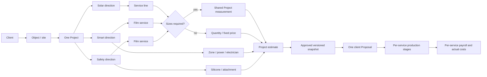

# Rolan PRO: multi-service Project flow

The implementation keeps one Project as the operational and financial container.

## Calculation ownership

1. `projectLines(o)` is the canonical commercial scope.
2. Window services use verified measurement area, warehouse material cost, service price and installer rate.
3. Quantity, zone, linear-foot and fixed services use their saved unit, quantity and Price Book values.
4. Direct expenses remain separate from service material/labor and can be scoped to Project, direction or service.
5. The estimate approval freezes the line list, measurements, materials, prices, payment terms and role-safe economics.
6. The Proposal is generated from that approved snapshot. It never recalculates or rebuilds a second scope.

## Operational ownership

- A service may have several production stages.
- Every stage has dates, crew, responsible specialist, optional contractor and dependency.
- Different services in the same Project may run on different dates with different specialists.
- The Project closes only when all required services/stages are complete; payments and payroll remain separate settlement events.
